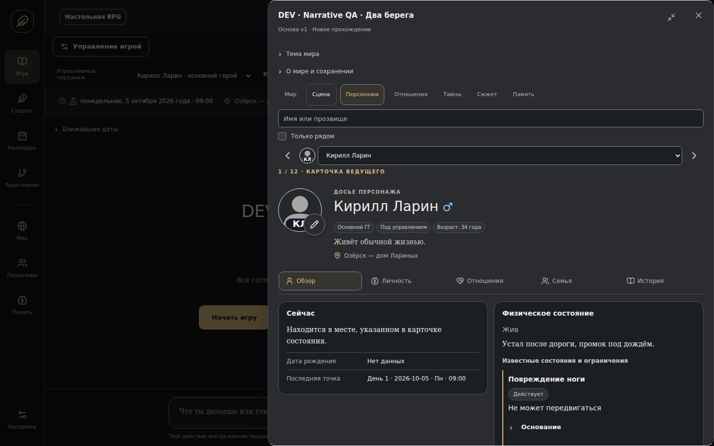
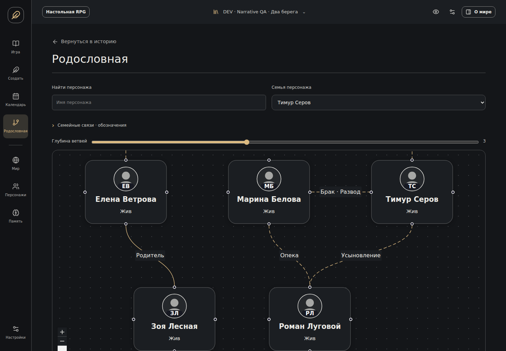
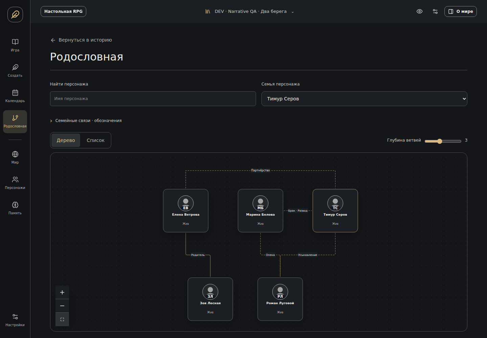

# Issue #83 — visual evidence

Real Chromium application captures. CSS viewport sizes are named in the files; Pixel emulation uses a higher device-pixel ratio. Baseline commit: `614c04fb60de46a5706259e446d67b4e146cb0ce` (merged #120). Same deterministic `ui-dossier` data is used for the baseline and dense dossier comparison. Baseline had no expanded layout or five-tab navigation.

## Before / after

| Screen | Before | After |
| --- | --- | --- |
| 360px · graphite | [Baseline](baseline-360-graphite.png) | [Overview](after-360-graphite-0.png) |
| 393px · graphite | [Baseline](baseline-393-graphite.png) | [Overview](after-393-graphite-0.png) |
| 768px · graphite | [Baseline](baseline-768-graphite.png) | [Overview](after-768-graphite-0.png) |
| 1440px · graphite | [Baseline](baseline-1440-graphite.png) | [Overview](after-1440-graphite-0.png) |
| Compact desktop 440px · graphite | [Baseline](baseline-1440-graphite.png) | [Compact](after-compact-440-graphite-0.png) |
| Family · desktop · graphite | [Baseline](baseline-family-desktop-graphite.png) | [After](after-family-desktop-graphite.png) |
| Family · mobile · graphite | [Baseline](baseline-family-mobile-graphite.png) | [After](after-family-mobile-graphite.png) |
| 360px · parchment | [Baseline](baseline-360-parchment.png) | [Overview](after-360-parchment-0.png) |
| 393px · parchment | [Baseline](baseline-393-parchment.png) | [Overview](after-393-parchment-0.png) |
| 768px · parchment | [Baseline](baseline-768-parchment.png) | [Overview](after-768-parchment-0.png) |
| 1440px · parchment | [Baseline](baseline-1440-parchment.png) | [Overview](after-1440-parchment-0.png) |
| Compact desktop 440px · parchment | [Baseline](baseline-1440-parchment.png) | [Compact](after-compact-440-parchment-0.png) |
| Family · desktop · parchment | [Baseline](baseline-family-desktop-parchment.png) | [After](after-family-desktop-parchment.png) |
| Family · mobile · parchment | [Baseline](baseline-family-mobile-parchment.png) | [After](after-family-mobile-parchment.png) |

### Narrow mobile · Graphite

| Before | After |
| --- | --- |
|  |  |

### Expanded desktop · Graphite

### Family · desktop

| Before | After |
| --- | --- |
|  |  |

## Every dossier tab

| Layout / skin | Overview | Personality | Relationships | Family | History |
| --- | --- | --- | --- | --- | --- |
| 360 · graphite | [Overview](after-360-graphite-0.png) | [Personality](after-360-graphite-1.png) | [Relationships](after-360-graphite-2.png) | [Family](after-360-graphite-3.png) | [History](after-360-graphite-4.png) |
| 360 · parchment | [Overview](after-360-parchment-0.png) | [Personality](after-360-parchment-1.png) | [Relationships](after-360-parchment-2.png) | [Family](after-360-parchment-3.png) | [History](after-360-parchment-4.png) |
| 393 · graphite | [Overview](after-393-graphite-0.png) | [Personality](after-393-graphite-1.png) | [Relationships](after-393-graphite-2.png) | [Family](after-393-graphite-3.png) | [History](after-393-graphite-4.png) |
| 393 · parchment | [Overview](after-393-parchment-0.png) | [Personality](after-393-parchment-1.png) | [Relationships](after-393-parchment-2.png) | [Family](after-393-parchment-3.png) | [History](after-393-parchment-4.png) |
| 768 · graphite | [Overview](after-768-graphite-0.png) | [Personality](after-768-graphite-1.png) | [Relationships](after-768-graphite-2.png) | [Family](after-768-graphite-3.png) | [History](after-768-graphite-4.png) |
| 768 · parchment | [Overview](after-768-parchment-0.png) | [Personality](after-768-parchment-1.png) | [Relationships](after-768-parchment-2.png) | [Family](after-768-parchment-3.png) | [History](after-768-parchment-4.png) |
| 1440 · graphite | [Overview](after-1440-graphite-0.png) | [Personality](after-1440-graphite-1.png) | [Relationships](after-1440-graphite-2.png) | [Family](after-1440-graphite-3.png) | [History](after-1440-graphite-4.png) |
| 1440 · parchment | [Overview](after-1440-parchment-0.png) | [Personality](after-1440-parchment-1.png) | [Relationships](after-1440-parchment-2.png) | [Family](after-1440-parchment-3.png) | [History](after-1440-parchment-4.png) |
| compact-440 · graphite | [Overview](after-compact-440-graphite-0.png) | [Personality](after-compact-440-graphite-1.png) | [Relationships](after-compact-440-graphite-2.png) | [Family](after-compact-440-graphite-3.png) | [History](after-compact-440-graphite-4.png) |
| compact-440 · parchment | [Overview](after-compact-440-parchment-0.png) | [Personality](after-compact-440-parchment-1.png) | [Relationships](after-compact-440-parchment-2.png) | [Family](after-compact-440-parchment-3.png) | [History](after-compact-440-parchment-4.png) |
| sparse-360 · graphite | [Overview](after-sparse-360-graphite-0.png) | [Personality](after-sparse-360-graphite-1.png) | [Relationships](after-sparse-360-graphite-2.png) | [Family](after-sparse-360-graphite-3.png) | [History](after-sparse-360-graphite-4.png) |
| sparse-360 · parchment | [Overview](after-sparse-360-parchment-0.png) | [Personality](after-sparse-360-parchment-1.png) | [Relationships](after-sparse-360-parchment-2.png) | [Family](after-sparse-360-parchment-3.png) | [History](after-sparse-360-parchment-4.png) |

`768` and `1440` are expanded layouts; `compact-440` is the dense card in the compact desktop panel. `sparse-360` is Vera with a concealed condition, checked through every tab including the Knowledge disclosure. Long biographies remain expandable.

## Portraits and graph alternatives

| Surface | Desktop Graphite | Desktop Parchment | Mobile Graphite | Mobile Parchment |
| --- | --- | --- | --- | --- |
| Portrait editor | [Open](portrait-editor-desktop-graphite.png) | [Open](portrait-editor-desktop-parchment.png) | [Open](portrait-editor-mobile-graphite.png) | [Open](portrait-editor-mobile-parchment.png) |
| Original viewer | [Open](portrait-viewer-desktop-graphite.png) | [Open](portrait-viewer-desktop-parchment.png) | [Open](portrait-viewer-mobile-graphite.png) | [Open](portrait-viewer-mobile-parchment.png) |
| Circular crop | [Open](portrait-card-desktop-graphite.png) | [Open](portrait-card-desktop-parchment.png) | [Open](portrait-card-mobile-graphite.png) | [Open](portrait-card-mobile-parchment.png) |
| Family list | [Open](after-family-list-desktop-graphite.png) | [Open](after-family-list-desktop-parchment.png) | [Open](after-family-list-mobile-graphite.png) | [Open](after-family-list-mobile-parchment.png) |

Portrait geometry uses a deliberately synthetic uploaded QA image. No image-generation call, fictional character portrait, or remote image is used.

Dense graph: [desktop](after-family-dense-desktop.png), [360px mobile](after-family-dense-mobile.png). Fixed nodes were checked pairwise for overlap; fit was checked against node and arc-label bounds.

## Interaction captures

| Scenario | Desktop | Mobile |
| --- | --- | --- |
| Start → ordinary turn → save/reload → ordinary turn | [Video](dossier-start-ordinary-desktop.webm) | [Video](dossier-start-ordinary-mobile.webm) |
| 80-node tree → list → dossier → tree; empty family; draft preserved | [Video](dossier-public-family-desktop.webm) | [Video](dossier-public-family-mobile.webm) |
| Pan / touch pinch → fit; two skins; reduced motion | [Video](dossier-gestures-desktop.webm) | [Video](dossier-gestures-mobile.webm) |

Smoke final screens: [desktop](smoke-desktop.png), [mobile](smoke-mobile.png).

## Scale measurements

Single-run browser samples, not benchmark guarantees. Render time includes root selection, API and layout until 80 nodes are present. Heap is Chromium `performance.memory.usedJSHeapSize` (coarse process measure); this is not physical Android memory. The graph is capped at 80 nodes from a 112-character fixture, with depth 1–6 and an accessible list.

| Sample | Nodes / roster | Time | JS heap |
| --- | --- | --- | --- |
| [Graph · desktop](performance-desktop.json) | 80 | 1354 ms | 24.5 MB |
| [Graph · mobile](performance-mobile.json) | 80 | 793 ms | 26.0 MB |
| [Roster search · desktop](performance-roster-desktop.json) | 112 | 136 ms | 20.5 MB |
| [Roster search · mobile](performance-roster-mobile.json) | 112 | 72 ms | 18.2 MB |

## Reproduction and review notes

Build `frontend` and run the `dossier*.spec.ts` Playwright suites with the repository test server. The dense/sparse fixture is `ui-dossier`; family fixtures are `ui-family` and `ui-family-dense`. Baseline captures were made from an isolated worktree at the stated commit, copying only the deterministic fixture/test-server support; production baseline source was unchanged. `dossier-before.capture.ts` is an opt-in capture helper (copy to `.spec.ts` in that baseline worktree, not the current app).

The first `before-*` captures preserve the initial audit. The `baseline-*` set supplies the matched fixture/viewport comparison above. Review covered the actual images and interaction captures, including full original portrait versus circular crop, both theme contrasts, tab overflow/keyboard navigation, long prose, fixed graph geometry, partner arcs, and mobile touch controls.

See [implementation, field/action preservation matrix, API/dependency audit and validation](../issue83-dossier.md).
