# Issue #87 — Narrative reading surface

База: `0a94f31e4e9a6c4d7676b6d1341996fde45be451` (master, PR #139).

## Аудит до изменений

1. **Чтение:** крупный заголовок, отдельные строки timing/variants/diagnostics и большие интервалы конкурировали даже с короткой сценой. В длинной истории всё форматирование Markdown запускалось сразу.
2. **Выбор действия:** сетка из двух колонок вне узкого mobile, крупные отступы; действие и реплика сливались. Один вариант занимал только половину desktop-колонки.
3. **Ввод:** autosize только на mobile; рамка textarea конфликтовала с рамкой контейнера при фокусе. Desktop требовал ручного изменения высоты.
4. **Телефон:** padding внутри scroller оставлял возможность перекрытия видимых controls свёрнутым устройством при чтении выше конца ленты.

Скриншоты `before-*` сняты с исходного production build, `after-*` — с изменённого. Один seed `phone`, одинаковые viewport 360×900, 393×900, 768×900, 1440×900; graphite и parchment; та же сцена, один choice, непрочитанное сообщение, тот же черновик. Отличаются технические save IDs/номер основы и timing выполнения. `keyboard` — эмуляция visualViewport=440px, не физическая Android-клавиатура.

## Владельцы и сохранение функциональности

| Область | Владелец | Что сохранено / проверяется |
|---|---|---|
| Scene fixation, время, погода | #45, MobileScene / SceneClock | Положение, canonical projection, calendar entry |
| История, streaming, commit | #72, useStoryScroll / NarrativeText | Одна прокрутка, стабильные identities, scroll-up, jump-to-latest, Retry |
| Досье, авторизованные ссылки | #83, Markdown / Inspector | Существующий серверный Markdown, имена/Knowledge не вычисляются в UI |
| Навигация, Inspector | #86, App / Inspector | Существующие панели, Escape/Back, возврат без remount истории |
| Телефон / CallScene | #45/#122/#136/#138 | Те же компоненты и команды, unread только из Save, отдельная история звонка |
| Свободный ход / choice | Game.turn | Тот же canSubmit, payload, revision, capabilities, busy/pending |
| Regenerate / варианты | NarrativeTurn, Game | Исходные handlers, confirmation, target/revision, архив следующих ходов |
| Rollback | Game | Подтверждение и существующий API |
| POV / actor / мир без ГГ | Game, WorldCamera, CurrentGame | Существующие команды и draft scope |
| TimeSkip / длительный переход | CurrentGame | Существующие диалоги и domain semantics |
| Диагностика / timing / ошибки | JobView / Diagnostics / Timing | Все стадии и controls доступны |
| Уведомления отношений | RuntimeNotifications | Существующий переключатель, только канонические изменения |
| Настройки чтения и скины | Preferences / ThemeProvider | Шрифт, ширина, интерлиньяж, surfaces/accent/density, декорации |

Интегрированные зависимости проверены в истории master: #45 → PR #120; #72 → #124; #83 → #121; #86 → #123; #122 → #133; #136 → #137; #138 → #139. Runtime, Extraction, WorldState, Knowledge, POV, API и сохранения не менялись. Изменение `tests/e2e_server.py` относится только к внешнему тестовому LLM provider: управляемая ошибка Extraction.

## Презентационная спецификация

- Колонка: заданная пользователем `reading_width` (по умолчанию 800px), 36px внутренние поля desktop, 18px mobile. Проза использует существующие `story-font`, `font_size`, `line_height`; пользовательские настройки не подменяются.
- Метаданные: 11px UI-шрифт, умеренный tracking, secondary text. Действие игрока: 14px/1.6, спокойная полоса с акцентом скина. Художественная проза без messenger bubbles.
- Choices: 14px/1.5, padding 10×12, минимум 44px, высота по содержимому. Действие и реплика — отдельные строки. Автоматические колонки от 280px; mobile — одна. Один вариант занимает доступную ширину. 0 choices не оставляет пустую рамку.
- Инструменты: общий footer хода, timing раскрывается штатным details; variants/regenerate/usage доступны мышью, touch и клавиатурой. Lucide вместо текстовых символов на mobile.
- Composer: 16px, измеряемая высота до 132px на всех ширинах, одна focus-рамка, submit ≥44px. Form submit и Ctrl/Cmd+Enter используют тот же canSubmit; IME composition не отправляет ход. Черновик и scope сохранены.
- Телефон: отдельная зарезервированная полоса у края viewport вместо padding внутри scroller; текущий ResizeObserver Phone по-прежнему привязывает устройство к высоте composer. Нового телефонного состояния/анимации нет.
- Короткий landscape: существующие controls уплотняются без замены навигации. Подробности ближайших дат/длительного перехода/таймскипа перенесены внутрь той же ленты; scene fixation остаётся перед ней. Jump-to-latest использует свободную часть полосы телефона и не забирает ещё одну строку высоты.
- Motion: существующие #45/#72 presets; мягкие border/background/press состояния. Reduced motion отключает декоративные transitions.
- Производительность: индекс ходов вычисляется один раз вместо findIndex на каждый renderEntry. Уже сохранённые сцены и действия игрока сразу показывают исходный текст; Markdown/link formatting запускается рядом с областью чтения (600px запас) и затем сохраняется. Streaming форматируется по прежнему контракту. Это не виртуализация и не новая система прокрутки.

## Решение по зависимостям

Новых библиотек нет. Использованы установленные React, Framer Motion, Lucide и существующие UI primitives. Radix уже владеет диалогами; нового меню/фокуса не требуется. Autosize реализован измерением существующего textarea и ResizeObserver ширины, без отдельной зависимости; scroll position остаётся у #72. Новых лицензий и framework bundle нет.

## Визуальные пары

| Состояние | До | После |
|---|---|---|
| Desktop, graphite | 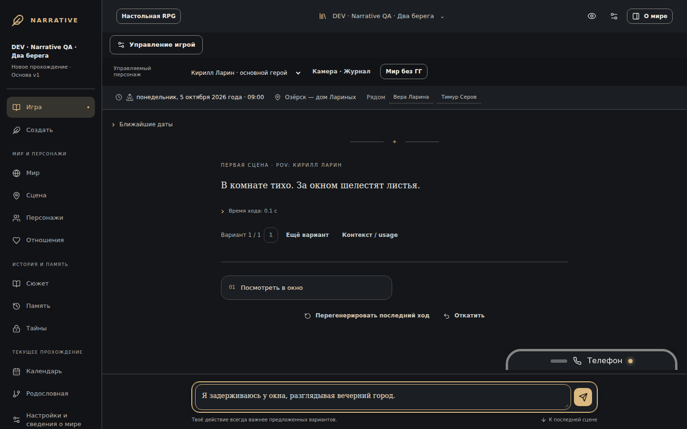 | 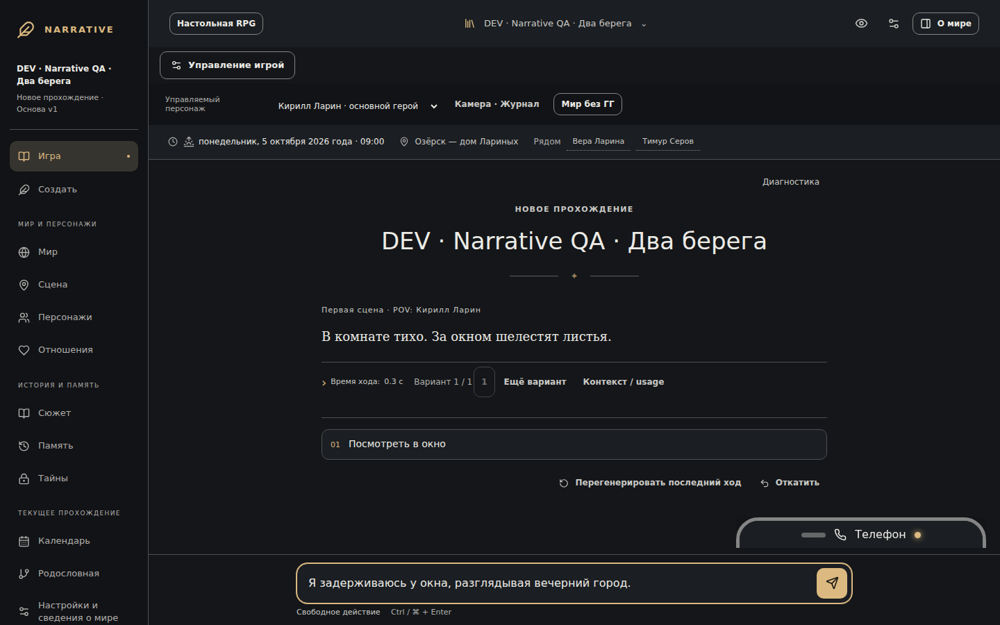 |
| Android 360, graphite | 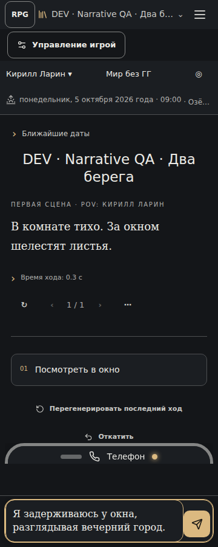 | 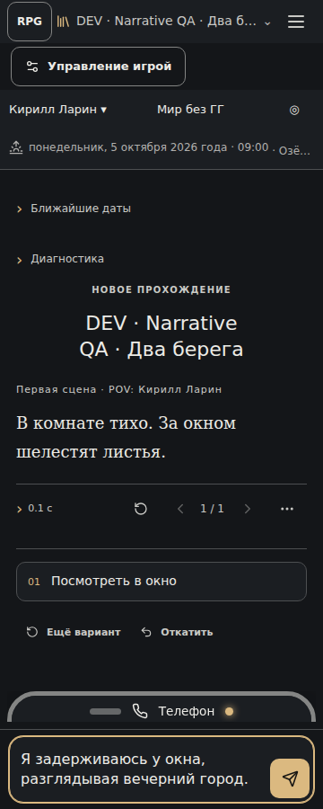 |
| Android 393, parchment | 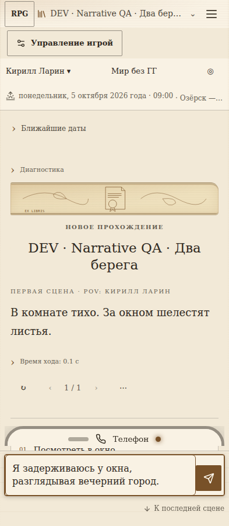 | 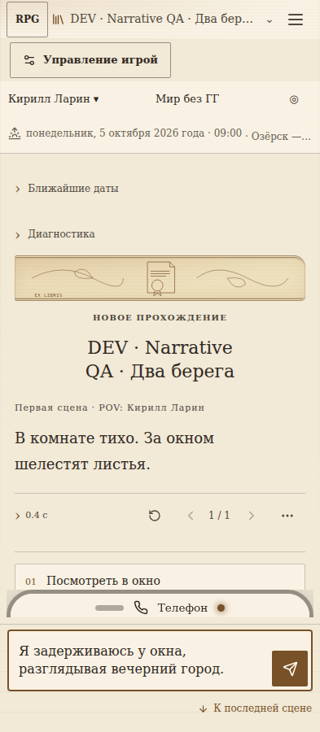 |
| Tablet, parchment | 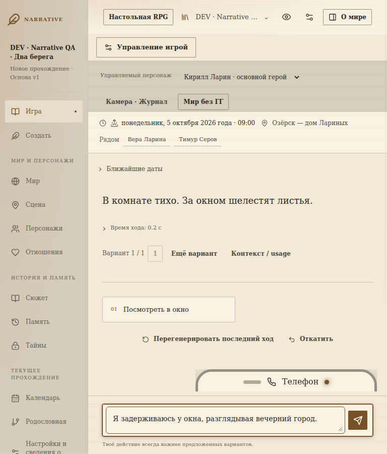 | 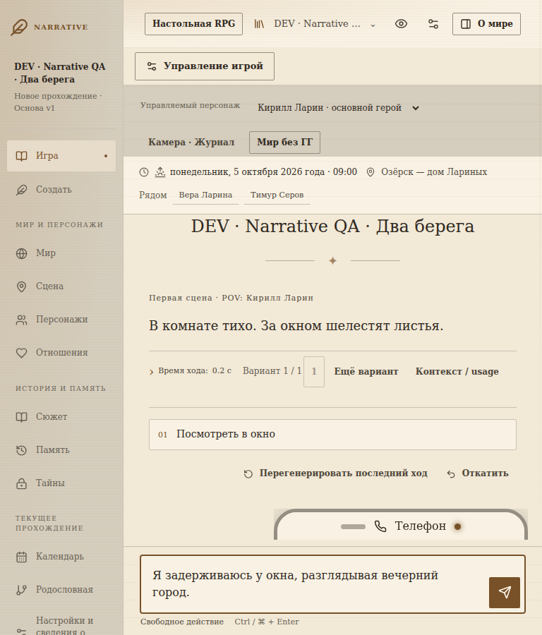 |
| Телефон, 360 | 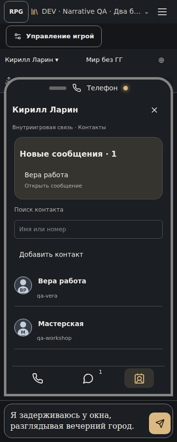 | 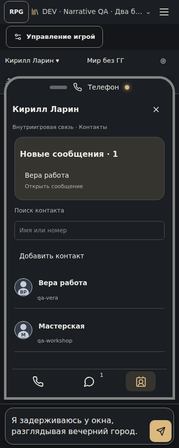 |
| Клавиатура, 393 | 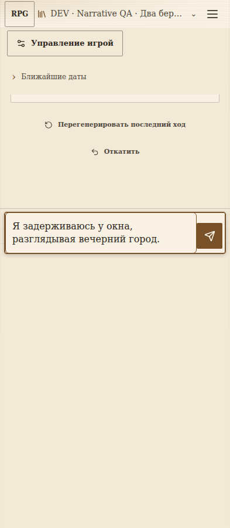 | 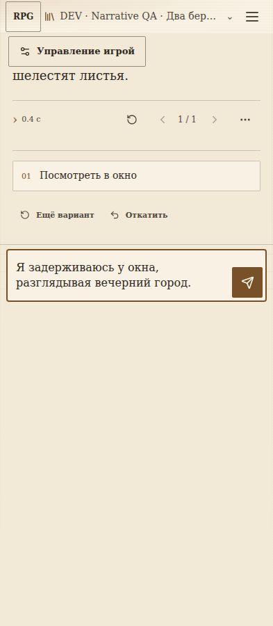 |

## Проверки

Финальная сборка `npm run build` прошла. `npm test`: 35 passed.
`python -m pytest -q tests/test_narrative_phone138.py`: 38 passed.
Основной Playwright-прогон: **36 passed, 10 skipped** (7.2m). Пропуски — повтор desktop-only viewport/landscape cases в mobile project. Соседний regression-прогон: **67 passed, 5 skipped** (9.0m). Итого: **103 passed, 15 skipped**, без падений. Пропуски соседнего прогона заданы существующими desktop-only тестами. Полные логи: [build](logs/build.log), [unit](logs/unit.log), [backend](logs/backend.log), [Playwright core](logs/core.log), [Playwright regression](logs/neighbors.log). Автоматика использует production frontend + настоящий FastAPI/jobs/SQLite и детерминированный внешний provider. Исключения явно ограничены presentation load/choice fixtures и контролируемым SSE-тестом #72; они не являются доказательством доменных правил.

### Воспроизведение

Из `frontend/`:

```sh
npm ci
npm run build
npm test
PLAYWRIGHT_EXECUTABLE_PATH=/path/to/chromium STREAM_EVIDENCE=../docs/manual_qa/narrative_v4/issue87/streaming npx playwright test reading87 streaming72 phone122-streaming --reporter=line
PLAYWRIGHT_EXECUTABLE_PATH=/path/to/chromium npx playwright test mobile-layout narrative-authority136 narrative-phone138 phone133 pov world-camera current-game narrative-skins runtime.spec parity tabletop --reporter=line
```

Из корня: `python -m pytest -q tests/test_narrative_phone138.py`.
`READING_BASELINE=1 npx playwright test reading87.spec.ts --project=desktop` снимает пары `before-*` (нужно предварительно собрать исходную ревизию).

### Реальный рендер и performance

Проверены PNG исходного и итогового production build: иерархия прозы/действия/метаданных, компактность choices, русские длинные строки, светлая и тёмная поверхности, focus и draft, dock телефона, composer и landscape. Исправлены двойная рамка ввода, обрезанная нижняя строка controls под телефоном, избыточная фиксированная высота в landscape. Автоматические геометрические проверки подтверждают отсутствие horizontal overflow и перекрытия reader/dock; они дополняют просмотр изображений.

| 1000 сохранённых ходов, presentation fixture | Desktop | Pixel emulation |
|---|---:|---:|
| Холодное открытие до ready | 11.40s | 11.90s |
| Median frame во время прокрутки | 16.2ms | 16.3ms |
| P95 frame | 38.1ms | 22.3ms |
| Heap до/после перемещений | 139/139 MB | 269/269 MB |

Это измерение данного CI-host, не гарантия для физического телефона. Heap округляется Chromium и не доказывает отсутствие утечек. 1000 ходов остаются в DOM: cold-start всё ещё дорогой, виртуализация сознательно не добавлена поверх #72.

В `streaming/` сохранены полные записи desktop/mobile для обычного и reduced motion, smoke и навигации, а также JSON samples. Контролируемый streaming-тест проверяет отсутствие mutations старых ходов, стабильность DOM при commit, сохранение scroll-up, ограниченный Markdown текущего хода. Примеры: [desktop motion](streaming/after-desktop-motion.webm), [mobile motion](streaming/after-mobile-motion.webm), [mobile reduced](streaming/after-mobile-reduced.webm).

## Ограничения

- Physical Android/IME/системный Back на настоящем устройстве не проверены: Chromium Pixel emulation, visualViewport resize и браузерный Back/Escape.
- Live DeepSeek не запускался. Автоматика проверяет интеграцию, а не качество свободной прозы модели.
- Скриншоты не доказывают полное соответствие WCAG; проверяются реальные размеры/переполнение, фокус и два контрастных скина.
- Исходное ТЗ задаёт визуальное направление словами; отдельный пиксельный макет в Issue #87 не приложен. Сравнение выполнено с актуальным приложением и описанными требованиями.
- Production build сохраняет существующее предупреждение Vite о JS chunk >500kB.
