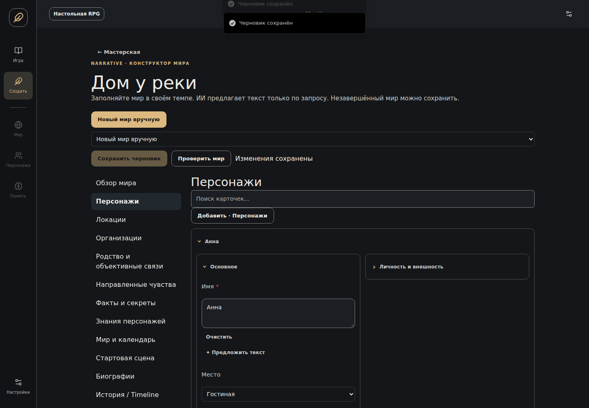
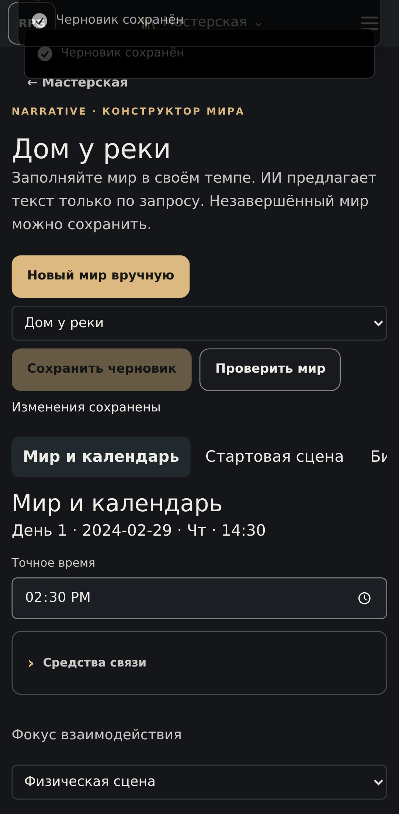

# Visual initial-world authoring (#117)

The manual mode opens from Create World → Создание мира вручную. It uses the existing
preparation workspace, append-only `world_draft` document versions and `draft/confirm` transaction.
The document contains an actual schema_version=3 canonical snapshot; this is the existing
Runtime v3→v4 aggregate, not a second runtime, migration or generator.

Automatic creation and its legacy draft editor retain their existing paths. The generic draft
read endpoint identifies a manual document and redirects the UI to its authoring adapter.
Manual workspaces have an independent selector and localStorage selection. Actor/POV secrets
are visible in this explicitly author-owned editor; normal game projections remain unchanged.

## Forms and validation

The schema endpoint is generated from current Pydantic definitions. Reference widgets select
existing entities; generated map keys and compound Knowledge/Relationship keys are not typed.
Nested object, list, dictionary, optional, enum, numeric, boolean and text fields are supported.
The field matrix is generated by `scripts/world_builder_matrix.py`.

Progressive UI: section navigation → searchable record cards → character subsections → nested
advanced fields. Mobile uses a horizontal section selector and single-column forms. Keyboard
controls use native inputs/buttons/details. The appearance remains based on application tokens.

An unfinished document can be saved even when Pydantic or canonical validation fails. Saving
uses the workspace revision inside a transaction. Debounced validation does not write a version.
Start Game is disabled with unsaved changes/errors, and the server repeats strict validation.
Deletion displays and rejects dependent references; history versions provide undo. Save does not
silently repair invalid authored fields. Gregorian weekday uses Calendar; custom profiles reuse
runtime arithmetic. Start date may be null without inventing a historical date.

## Provider boundary

The preparation worker recognizes a bounded `draft_builder` proposal task. Existing provider,
credentials, cancellation and tracked_stream accounting are reused. A completed proposal is
stored in the job response, without advancing the draft revision. The matching revision is
required to display/apply it. Preview offers accept/reject; accept stages the edit, save commits
it. Technical references, enum values and neighbouring records are protected. Missing credentials
never prevent manual authoring. The token/diagnostics dialog uses existing request records.

## QA with the existing #78 world

Baseline and named checkpoints remain unchanged. Use the existing `build_fixture('residence-roles')`
and `build_fixture('family')` through `migrate_v2` to obtain canonical snapshots for developer comparisons of the fields in the matrix.
The integration test `test_history_ordinary_turn_save_reload_and_next_turn` creates an isolated
SQLite workspace, initial secret/history, independent camera/control, starts the same runtime,
performs start/ordinary turn/reload/next ordinary turn and checks Knowledge isolation.

Manual checklist in an isolated dev database:
1. Create an empty manual draft, add two named characters and a parent/child pair of locations.
2. Add an organization and role; add spouse/parent objective ties separately from A→B and B→A feelings.
3. Add a secret, then separate known/suspected Knowledge records. Add a prior discovery event and
   explicitly link the source. Verify no implicit broadcast of Knowledge.
4. Choose Gregorian 2024-02-29, 14:30: weekday is Thursday. Clear date; choose weekday/time.
   Switch to a custom two-month calendar and verify its dates using runtime projection.
5. Delete a referenced character/location/event: inspect dependencies and cancel. Remove a free
   record, save, restore prior version, reload. Existing records and revisions survive.
6. Generate scene/character prose with controlled provider responses. Reject, then accept and
   save a proposal. Confirm only the selected target changes; restore to undo it.
7. Set camera/control/POV independently, save, check, Start Game, ordinary turn, reload and next turn.
8. On the started game exercise existing rollback/branch/regenerate UI as in #78; no authoring
   special case or second resolver is involved.

The Playwright scenario drives real manual forms on desktop and mobile. Tests use controlled
responses; live paid DeepSeek generation is not mandatory in CI and requires user credentials.

## Verified checks

- `python -m pytest tests/test_world_builder.py tests/test_draft_world.py tests/test_worlds.py tests/test_runtime_v3_storage.py -q`: **75 passed**.
- `npm run build --prefix frontend`: passed (existing large-chunk advisory remains).
- `PLAYWRIGHT_EXECUTABLE_PATH=/tmp/issue117-chrome/chromium npm run test:e2e --prefix frontend -- world-builder.spec.ts draft-world.spec.ts --grep 'manual world|field proposals|new visitor'`: **6 passed**, desktop/mobile.
- Chromium was obtained as a temporary test dependency outside the repository; no browser/npm runtime dependency added to the application.
- Automatic creation, manual rich-world creation, proposal rejection/acceptance and reload are covered. Paid live DeepSeek calls were not made; provider behavior is verified with controlled responses.

## Deliberate boundaries

- Portrait uploads remain in the existing game portrait manager; raw asset references are read-only in the pre-game editor.
- AI proposals preserve technical references, numeric values and enums. It fills textual content in the selected card; a new character proposal includes a structured personality template. Authors create entities and select their links themselves.
- Arbitrary campaign/biography prose is not checked for semantic truth by a second LLM. Strict model validation, canonical invariants and structural references are enforced.
- The full project test suite is not represented by the focused result above; CI runs the repository-wide suite.

